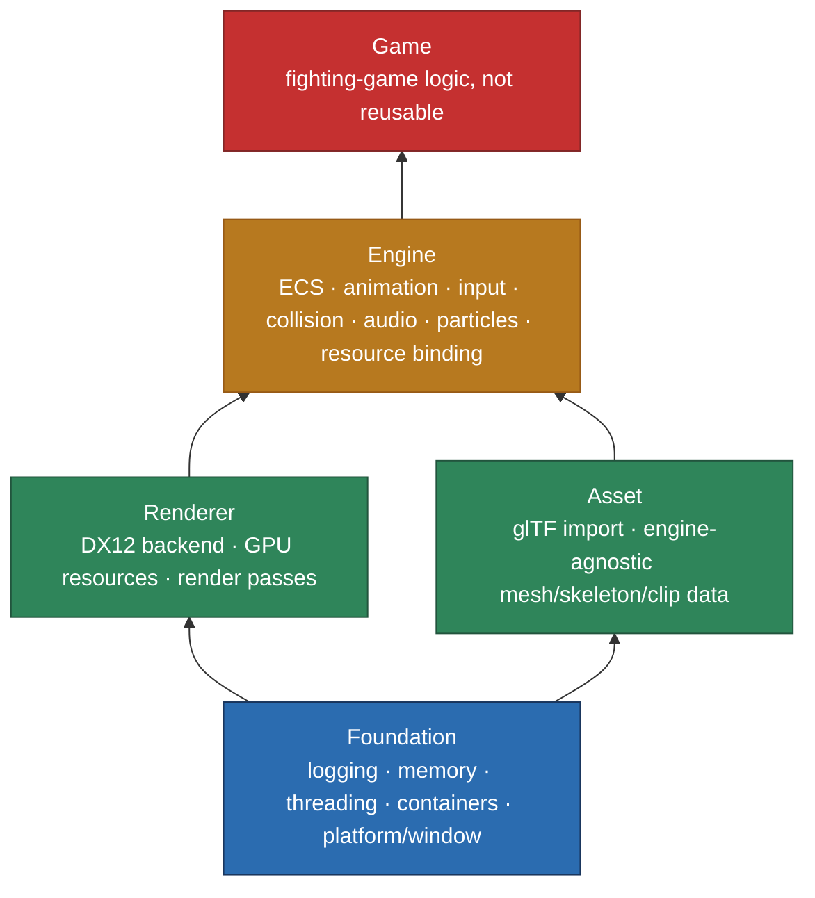

# OmdLab

A hobby game engine built on DirectX 12 (AI-assisted programming), driving a 2D-camera fighting game with minimalistic 3D characters.

*Prototype showcase video (click to watch on YouTube).*

## Highlights

- **Custom tech, minimal dependencies**: own DX12 renderer, skeletal animation runtime, collision, input and fixed-timestep simulation. Third-party code is limited to EnTT, Dear ImGui, cgltf, stb and miniaudio.
- **Data-driven design**: a hand-written combat DSL (`.combat`) defines states, moves, hitboxes, cancels and frame data; key bindings are plain text. Both hot-reload while running.
- **Animation tooling**: an in-engine animation editor (move preview and frame scrubbing, hitbox placement, clip-timing curves, all saved back to the `.combat` files), on top of a runtime with crossfades, blend-space locomotion and bone-attached hitboxes. A headless capture harness provides deterministic regression checks and metrics.
- **Gameplay layers**: SFX and music, CPU particle VFX, an in-game HUD and menus, and a rule-based AI opponent (including an AI-vs-AI mode with a seeded, repeatable fight director).

## Architecture

| Project | Role | Depends on |
|---|---|---|
| `Foundation` | Platform layer, logging, memory tracking, threading, core containers. | — |
| `Renderer` | Generic DX12 abstraction: device, GPU resources, render passes, pipelines. No knowledge of game or asset concepts. | `Foundation` |
| `Asset` | Import-format-agnostic mesh/skeleton/animation data structures, populated by a glTF importer. | `Foundation` |
| `Engine` | ECS, animation runtime, input, collision, audio, particles, fixed-timestep simulation, and the resource layer connecting `Asset` data to `Renderer` GPU resources. | `Foundation`, `Renderer`, `Asset` |
| `Game` | Fighting-game-specific logic and content: combat DSL, fighter state machine, AI, HUD, VFX/SFX cues. Not reusable. | `Engine` |

## Building

1. Run `GenerateSolution.bat` from the repo root to generate the Visual
   Studio solution/project files under `projects/` (regenerate any time
   `build/*.sharpmake.cs` changes).
2. Open `projects/omdlab_win64_vs2022.sln` and build. The first build
   requires internet access: it restores the DirectX Agility SDK via NuGet
   and copies its runtime DLLs next to the built executable.

## Status

Playable prototype: two fighters with combos, cancels, aerials, blocking, a fireball special, HUD, hit effects, sound, and a CPU opponent. Work in progress; next steps are not yet scheduled.

## License

Source code is licensed under the [MIT License](LICENSE). This does not
cover everything in the repository — see [NOTICE.md](NOTICE.md) for
vendored third-party code and data assets under their own separate
licenses.
